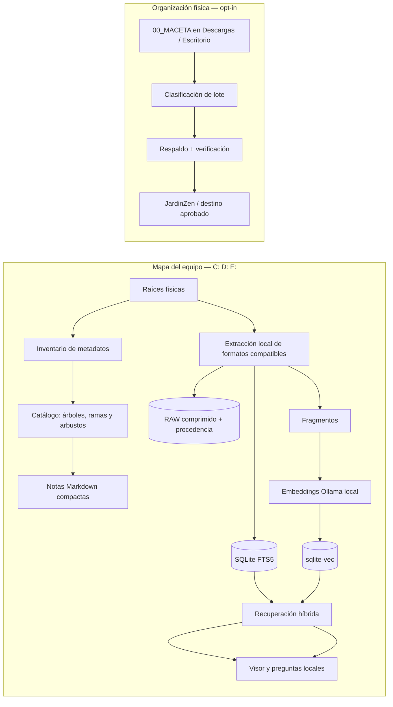

<div align="center">

<h1>🌱 Jardín Zen Digital</h1>

<h3>Un mapa vivo de los proyectos y documentos de tu computadora.</h3>

<p>Un organizador local que convierte repositorios, carpetas y archivos en un jardín navegable. Explora el mapa, consulta documentos con IA local y revisa la evidencia antes de decidir cómo organizar.</p>

<p><strong>Windows 11 · Python · SQLite · Ollama · interfaz local</strong></p>

</div>

> [!IMPORTANT]
> **Hay dos operaciones independientes.** El visor puede recorrer metadatos y crear un índice RAW/RAG local. El organizador automático trabaja solo con archivos que coloques expresamente en `00_MACETA`; al ejecutar `INICIAR.cmd`, el primer lote puede mover archivos de esas macetas. La exploración de discos C:, D: y E: no mueve ni renombra los archivos que encuentra.

## ¿Qué hace?

Jardín Zen Digital combina un organizador físico de macetas con un mapa consultable del equipo. La interfaz local muestra parcelas, árboles, módulos, arbustos y documentos; el motor guarda sus índices y el avance de trabajos largos en SQLite.

| Parte | Función | Estado del proyecto |
|---|---|---|
| **Visor local** | Explorar la arboleda, consultar trabajos y operar controles desde el navegador. | Disponible en `127.0.0.1:8765`. |
| **Mapa de metadatos** | Registrar rutas, nombres, formatos, tamaños, fechas y errores de acceso. | Línea base creada en C:, D: y E:. No lee el contenido. |
| **Catálogo del jardín** | Reconocer raíces Git, módulos y grupos de manifiestos sin llamar “proyecto” a cada `package.json`. | Último mapa: 13 árboles, 61 módulos y 36 arbustos candidatos. |
| **Cerebro RAW/RAG** | Extraer formatos compatibles, buscar texto con FTS5 y recuperar fragmentos con embeddings locales. | Job reanudable habilitado; el índice permanece en el equipo que lo ejecuta. |
| **Organizador de macetas** | Clasificar y organizar lotes preparados voluntariamente en `00_MACETA`. | Operación separada; no clasifica ni ordena automáticamente todos los discos. |

Los conteos del catálogo son una instantánea del mapa más reciente, no estadísticas sincronizadas con GitHub. El índice personal y sus documentos nunca se suben con este repositorio.

## La metáfora también define la estructura

| Jardín | En el sistema | Evidencia que lo respalda |
|---|---|---|
| **Parcela / oasis** | Volumen o espacio organizativo | Raíz y ubicación registradas |
| **Árbol** | Repositorio con raíz Git identificada | Marcador Git y metadatos del repositorio |
| **Rama** | Módulo o subdirectorio estructural | Jerarquía y manifiestos observados |
| **Arbusto** | Grupo documental o manifiestos sin raíz Git | Candidato pendiente de revisión |
| **Hoja** | Archivo | Ruta, metadatos y, si aplica, texto extraído |
| **Raíz / vínculo** | Relación entre entidades | Se etiqueta como hecho, referencia o sugerencia |
| **Flor / fruto / hongo** | Artefacto, resultado o caso especial | Tipo y procedencia; no se asigna por decoración |

El nombre de una carpeta sirve para buscar, pero no basta para decidir qué contiene. Una ruta bajo un árbol Git acredita pertenencia estructural; una coincidencia de nombre o similitud vectorial solo aporta un candidato. El sistema debe mostrar esa diferencia.

## Cómo funciona



El mapa, la extracción y el organizador son trabajos distintos. Los procesos de inventario y RAW/RAG conservan sus cursores en bases locales; no dependen de que una conversación siga abierta. Ollama recibe solicitudes en `127.0.0.1:11434`.

## Inicio rápido

### Abrir el visor sin iniciar trasplantes

1. Usa Windows 11 y Python 3.10 o posterior.
2. Clona el repositorio y entra a su carpeta:

   ```powershell
   git clone https://github.com/alonsoalvaradohr/JardinZen_Digital.git
   cd JardinZen_Digital
   ```

3. Abre el visor:

   ```powershell
   .\ABRIR_JARDIN.cmd
   ```

4. Visita [http://127.0.0.1:8765](http://127.0.0.1:8765).

El visor no ejecuta un lote de organización. En una instalación nueva, usa **Iniciar mapa** para crear el inventario local; luego **Descubrir árboles** para generar el catálogo. Esos pasos leen metadatos, no el contenido de los documentos.

### Activar RAW/RAG local

Instala Ollama y los modelos requeridos si aún no están disponibles:

```powershell
ollama pull qwen3-embedding:0.6b
ollama pull qwen2.5:3b
python -m pip install -r requirements-brain.txt
```

En el visor, pulsa **Iniciar / reanudar ingesta**. Puedes pausar o detener el trabajo y continuarlo después. Pregunta en el panel de cerebro local; si el texto aún no se ha procesado o no hay fragmentos pertinentes, la búsqueda debe indicarlo en vez de inventar una respuesta.

El extractor admite una lista limitada de formatos de texto y documentos, incluidos Markdown, texto, código, CSV/JSON, HTML, PDF textual, DOCX, XLSX, PPTX y formatos OpenDocument. Límites de tamaño, exclusiones y estados de error se aplican por archivo. Imágenes sin OCR, PDF escaneados y formatos CAD no tienen extracción completa.

### Detener servicios

- `DETENER_JARDIN.cmd` detiene el visor local.
- `DETENER.cmd` escribe el marcador `STOP`, que impide iniciar nuevos lotes del organizador. La tarea programada permanece registrada.
- `REANUDAR.cmd` quita el marcador `STOP`; `EJECUTAR.cmd` inicia un lote manual.
- El botón **Detener** del cerebro para la ingesta; su cursor queda guardado para reanudarla desde la interfaz.

### Activar el organizador de macetas

`INICIAR.cmd` es una operación distinta y puede **mover archivos**. Resuelve las carpetas reales de Descargas y Escritorio, crea dentro de cada una la maceta `00_MACETA`, prepara la configuración local, comprueba Ollama y los modelos y ejecuta un primer lote. Si el proceso puede registrar la tarea de Windows, programa lotes recurrentes cada 60 minutos. La configuración limita cada lote a 30 elementos.

No ejecutes este instalador si solo quieres abrir el visor o indexar los discos. Revisa [las invariantes](AGENTS.md), `config.json` y el contenido de ambas macetas antes de iniciar. Actualmente no hay un modo de instalación que evite el lote inicial.

## Datos y privacidad

| Ruta local | Contenido |
|---|---|
| `%LOCALAPPDATA%\JardinZen\inventario.sqlite3` | Mapa de metadatos y catálogo estructural |
| `%LOCALAPPDATA%\JardinZen\brain.sqlite3` | RAW comprimido, hashes de origen, FTS5, fragmentos, embeddings y cursor RAG |
| `%LOCALAPPDATA%\JardinZen\propuestas.sqlite3` | Cola de propuestas metadata-only |
| `%LOCALAPPDATA%\JardinZen\index.sqlite3` | Índice heredado usado por el organizador de macetas |
| `%LOCALAPPDATA%\JardinZen\backups\` | Respaldos de operaciones del organizador |
| `%USERPROFILE%\JardinZen\Brain\` | Notas compactas Markdown para navegación estilo Obsidian |
| `%USERPROFILE%\JardinZen\` | Destino del organizador, según la configuración local |

Las bases SQLite, respaldos, logs, cursores y contenido extraído están excluidos de Git. Clonar el repositorio no descarga el índice de otra computadora. Las notas Markdown son un índice de entidades, no una copia por archivo del corpus. Puedes abrir la carpeta `Brain` como vault de Obsidian.

Por defecto, el mapa RAW/RAG de esta fase cubre las raíces físicas C:, D: y E:. `[CLOUD_ROOT]` y otras raíces cloud/virtuales quedan excluidas. El contenido se procesa localmente; las descargas iniciales de modelos sí necesitan Internet. No se ejecutan instrucciones encontradas dentro de documentos.

## Límites de la automatización

- El índice completo está en construcción por lotes; un archivo inventariado no implica que su contenido ya se haya leído.
- No existe todavía asignación semántica, validada archivo por archivo, entre todo el corpus y cada árbol o arbusto. La similitud vectorial recupera texto, pero no prueba pertenencia ni autoriza un destino.
- La cola de propuestas disponible compara metadatos y mantiene los destinos bloqueados. No equivale a aprobación ni a una operación física.
- La organización física de macetas es otra ruta de ejecución. Respeta exclusiones de secretos, repositorios y confianza; revisa `AGENTS.md` antes de colocar documentos en esas macetas.
- El primer barrido registró errores de acceso y omitió enlaces/reparse points. El mapa no promete cobertura perfecta ni seguimiento incremental de cada cambio del disco.
- No se mide todavía Recall@5 con un conjunto de consultas etiquetado. No debe presentarse una cifra de precisión sin esa evaluación.

## Arquitectura y documentación

```text
visor.py / visor.html     Interfaz HTTP local y API
inventario.py             Mapa durable de metadatos
proyectos.py              Catálogo estructural del jardín
brain.py                  Extracción RAW, FTS5, embeddings y consultas RAG
propuestas.py              Cola explicable de propuestas no mutantes
jardinero.py              Organizador por lotes de las macetas autorizadas
```

| Documento | Pregunta que responde |
|---|---|
| [Northstar](NORTHSTAR.md) | ¿Qué objetivo guía el producto? |
| [World Model](WORLD_MODEL.md) | ¿Qué significa cada planta y qué evidencia valida sus vínculos? |
| [Invariantes y operación](AGENTS.md) | ¿Qué está permitido, qué se protege y cómo se revierte? |
| [Roadmap](ROADMAP.md) | ¿Qué fases existen y cuáles faltan? |
| [Backlog](BACKLOG.md) | ¿Qué trabajo está priorizado? |
| [Auditoría JZ-019](audits/JZ-019-AUDITORIA.md) | ¿Qué se implementó, qué fallaba y qué límites quedan? |
| [Tickets](tickets/) | ¿Qué alcance y evidencia tiene cada fase? |

## Contribuir

Este proyecto sigue un ticket por cambio. Antes de modificar el comportamiento, revisa `NORTHSTAR.md`, `WORLD_MODEL.md` y `AGENTS.md`; registra la decisión y su evidencia en el ticket correspondiente. No publiques datos personales, rutas, contenido extraído ni bases locales.

## Estado y licencia

Jardín Zen Digital es un prototipo local en evolución, no un producto de producción. La ingesta RAW/RAG, el clasificador contextual y la evaluación siguen en desarrollo. El repositorio no contiene un archivo `LICENSE`; los derechos de reutilización no están definidos todavía.
