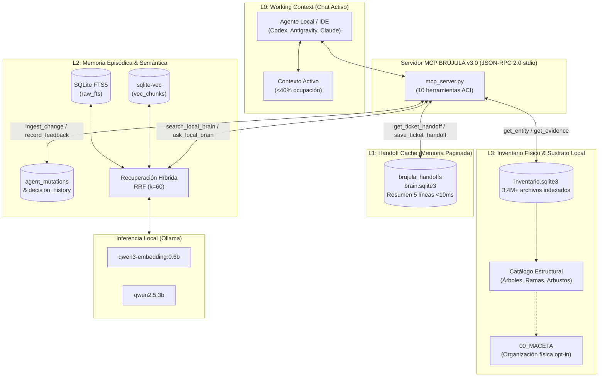

<div align="center">

# 🌱 Jardín Zen Digital

### Local-First AI OS & Knowledge Substrate with MemGPT-Style Hierarchical Memory & BRÚJULA Governance

[](LICENSE)
[](https://www.python.org/)
[](brain.py)
[](https://ollama.com/)
[](docs/plantillas_brujula/guia-operativa-brujula.md)
[](CITATION.cff)

*Un sustrato cognitivo local que convierte millones de archivos, repositorios y documentos en un jardín de conocimiento vivo, gobernable mediante el arnés BRÚJULA y agentes de contexto jerárquico sin telemetría ni fugas a la nube.*

---

</div>

## 1. ¿Qué es Jardín Zen Digital?

**Jardín Zen Digital** es un mapa vivo de conocimiento local y un arnés cognitivo gobernado (**BRÚJULA**) diseñado para operar sobre grandes volúmenes de datos locales (más de 3.4 millones de archivos indexados y más de 1.1 millones de pasajes vectoriales) bajo un principio de **privacidad absoluta y cero fugas a la nube**.

Inspirado en la arquitectura de memoria paginada de **MemGPT**, desacopla la ventana activa de los agentes (`L0`) de la memoria de handoffs durables (`L1`), memoria episódica/semántica (`L2`) y del inventario físico del disco (`L3`). Toda inferencia de lenguaje y generación de embeddings se ejecuta enteramente en el hardware local mediante **Ollama** y extensiones seguras de **SQLite**.

### Principios Fundamentales

- **Privacidad Local Absoluta:** Ningún contenido, nombre de archivo o ruta privada sale del equipo hacia APIs externas.
- **Evidencia Estructural vs. Candidato Semántico:** Una ruta bajo un árbol Git acredita pertenencia estructural verificable; la similitud vectorial (`sqlite-vec`) y búsqueda de texto (`FTS5`) aportan candidatos explicables, no decisiones irreversibles.
- **Uso Gobernado y Mutación Atómica:** Separación estricta de lectura, feedback y mutaciones (`ingest_change`). Las operaciones sobre el sistema de archivos aplican validación anti-path-traversal y verificación de hashes SHA-256 pre/post.
- **Higiene Determinista:** Cada cambio en el repositorio es auditado por `brujula_hygiene.py` garantizando 0 enlaces rotos, 0 duplicados y 0 secretos.

---

## 2. Arquitectura MemGPT + BRÚJULA

El flujo operativo distribuye la carga entre la ventana de contexto de los modelos y los estratos de persistencia durables en SQLite:



---

## 3. Estratos de Memoria y Módulos Principales

| Estrato | Función y Persistencia | Módulos del Repositorio |
|---|---|---|
| **L0 — Working Context** | Ventana de conversación activa mantenida por debajo del 40% de saturación de contexto con cortacircuitos de seguridad. | [visor.html](visor.html) / [visor.py](visor.py) |
| **L1 — Handoff Cache** | Paginación instantánea de estado entre chats. Permite a agentes reanudar tareas en menos de 10 ms sin relectura de historiales. | [tickets/](tickets/) / [STATE.md](STATE.md) |
| **L2 — Episódica / Semántica** | Base de conocimiento RAW/RAG con embeddings vectoriales, búsqueda full-text y registro durable de decisiones de agentes. | [brain.py](brain.py) / [propuestas.py](propuestas.py) |
| **L3 — Inventario Físico** | Mapeo continuo del sistema de archivos local, detección de raíces Git y catálogo de módulos. | [inventario.py](inventario.py) / [proyectos.py](proyectos.py) / [jardinero.py](jardinero.py) |

### Herramientas MCP BRÚJULA (`mcp_server.py`)

El servidor expone herramientas estandarizadas para agentes compatibles con el Model Context Protocol:

| Herramienta MCP | Módulo Vinculado | Propósito Operativo |
|---|---|---|
| `search_local_brain` | [brain.py](brain.py) | Búsqueda híbrida ponderada (RRF $k=60$) combinando FTS5 y `sqlite-vec`. |
| `ask_local_brain` | [brain.py](brain.py) | Síntesis generativa local con Ollama respaldada por citas verificables `[n]`. |
| `get_entity` | [proyectos.py](proyectos.py) | Inspección de ontología de árboles Git, módulos y carpetas en el World Model. |
| `get_evidence` | [inventario.py](inventario.py) | Inspección documental segura no bloqueante (`immutable=1`) de archivos. |
| `record_feedback` | [propuestas.py](propuestas.py) | Registro durable de aprobación/rechazo humano en `decision_history`. |
| `ingest_change` | [jardinero.py](jardinero.py) | Mutación de archivos con validación anti-path-traversal y hashes SHA-256. |
| `open_code_window` | [inventario.py](inventario.py) | Lectura precisa de fragmentos de código ($\le 80$ líneas) con ofuscación de secretos. |
| `save_ticket_handoff` | [brain.py](brain.py) | Registro durable L1 del resumen canónico de 5 líneas para continuidad de agentes. |
| `get_ticket_handoff` | [brain.py](brain.py) | Recuperación en $<10\text{ ms}$ del último estado de un ticket operativo. |
| `inspect_scratch_log` | [inventario.py](inventario.py) | Inspección de colas de logs en staging sin saturar el contexto del agente. |

---

## 4. Metáfora Estructural del Jardín

Jardín Zen Digital organiza el sistema de archivos a través de una ontología legible:

| Término | Correlato en el Sistema | Evidencia Requerida |
|---|---|---|
| **Parcela / Oasis** | Volumen o espacio raíz de almacenamiento | Raíz de disco montada y registrada |
| **Árbol** | Repositorio con raíz Git formal | Presencia de `.git/` y metadatos validados |
| **Rama** | Módulo o subdirectorio arquitectónico | Jerarquía estructural y manifiestos reconocidos |
| **Arbusto** | Colección documental sin raíz Git | Candidato evaluado pendiente de formalización |
| **Hoja** | Archivo individual | Metadatos físicos y texto extraído en RAW |
| **Flor / Fruto / Hongo** | Artefacto compilado o caso especial | Clasificación determinista por extensión y origen |

---

## 5. Quick Start Reproducible

### Requisitos Previos

- **Sistema Operativo:** Windows 10/11 (soporte Linux y macOS en desarrollo).
- **Python:** Versión 3.10 o superior.
- **Ollama:** Instancia local en ejecución en `http://127.0.0.1:11434`.

### Paso 1: Clonar el Repositorio

```bash
git clone https://github.com/alonsoalvaradohr/JardinZen_Digital.git
cd JardinZen_Digital
```

### Paso 2: Configuración del Entorno

Copia la plantilla de configuración de ejemplo para inicializar tus parámetros locales:

```bash
cp config.example.json config.json
```

Contenido base de [config.example.json](config.example.json):
```json
{
  "version": 1,
  "classify_model": "qwen2.5:3b",
  "embed_model": "qwen3-embedding:0.6b",
  "min_confidence": 0.85,
  "max_items_per_run": 30,
  "max_item_bytes": 1500000000,
  "max_backup_bytes": 1500000000,
  "schedule_minutes": 60,
  "external_roots": [],
  "privacy": "strict_local",
  "permissions": "only_pots_to_garden"
}
```

### Paso 3: Descarga de Modelos e Instalación de Dependencias

```bash
# Modelos locales en Ollama
ollama pull qwen3-embedding:0.6b
ollama pull qwen2.5:3b

# Dependencias Python de procesamiento vectorial
python -m pip install -r requirements-brain.txt
```

### Paso 4: Iniciar el Visor Local

En Windows:
```powershell
.\ABRIR_JARDIN.cmd
```

O directamente mediante Python:
```bash
python visor.py
```

Abre tu navegador en [http://127.0.0.1:8765](http://127.0.0.1:8765) para explorar el mapa de conocimiento local y realizar consultas asistidas por IA.

---

## 6. Seguridad, Privacidad y Almacenamiento Local

Toda la persistencia se realiza en bases de datos locales SQLite protegidas que nunca deben ser versionadas en Git:

| Base de Datos / Directorio | Función Operativa |
|---|---|
| `%LOCALAPPDATA%\JardinZen\inventario.sqlite3` | Catálogo de metadatos de archivos y árboles estructurales. |
| `%LOCALAPPDATA%\JardinZen\brain.sqlite3` | Almacén RAW, fragmentos de texto, índice FTS5 y vectores de similitud. |
| `%LOCALAPPDATA%\JardinZen\propuestas.sqlite3` | Registro y cola de decisiones de clasificación pendientes. |
| `%LOCALAPPDATA%\JardinZen\index.sqlite3` | Historial durable de decisiones (`decision_history`) y clasificaciones. |
| `%LOCALAPPDATA%\JardinZen\backups\` | Respaldos de seguridad generados antes de cualquier trasplante físico. |

> [!IMPORTANT]
> El repositorio cuenta con reglas estrictas en [.gitignore](.gitignore) para evitar cualquier fuga de bases de datos `*.sqlite3`, copias de respaldo o cachés locales.

---

## 7. Roadmap & Help Wanted

Buscamos colaboradores de la comunidad open-source para expandir las capacidades del ecosistema:

- [ ] **Soporte Multiplataforma Nativo (Linux & macOS):** Portar scripts `.cmd`/`.ps1` a bash/zsh estándar y adaptar rutas POSIX en escáneres de discos.
- [ ] **Conectores de Embeddings Alternativos:** Soporte para Hugging Face Text Embeddings Inference (TEI), llama.cpp nativo y ONNX Runtime.
- [ ] **Optimizaciones en el Visor (`127.0.0.1:8765`):** Visualización interactiva WebGL/3D para el grafo del World Model y streaming en tiempo real de consultas RRF.
- [ ] **Evaluación Sistemática de Recuperación:** Benchmarking estandarizado de `Recall@5` y `MRR` con corpus de evaluación sintéticos locales.

Revisa las pautas de contribución en [CONTRIBUTING.md](CONTRIBUTING.md) y el código de conducta en [CODE_OF_CONDUCT.md](CODE_OF_CONDUCT.md).

---

## 8. Documentación Canónica

- [Northstar del Proyecto](NORTHSTAR.md): Visión de producto y directrices de diseño.
- [Modelo del Mundo (World Model)](WORLD_MODEL.md): Ontología de entidades y relaciones del jardín.
- [Invariantes Operativas de Agentes](AGENTS.md): Reglas de seguridad para agentes autónomos.
- [Auditoría del Sistema](audits/JZ-019-AUDITORIA.md): Resultados técnicos y benchmarks de ingesta.
- [Historial de Tareas y Tickets](tickets/): Registro y trazabilidad de cambios por fase.

---

## 9. Citación y Licencia

### Citación Académica

Si utilizas la arquitectura de Jardín Zen Digital o el protocolo BRÚJULA en investigaciones o desarrollos técnicos, por favor cita el proyecto utilizando los metadatos en [CITATION.cff](CITATION.cff):

```bibtex
@software{jardinzen_digital_2026,
  author = {Alvarado, Alonso},
  title = {JardinZen Digital: Local-First AI OS & Knowledge Substrate},
  year = {2026},
  url = {https://github.com/alonsoalvaradohr/JardinZen_Digital},
  license = {AGPL-3.0}
}
```

### Licencia

Distribuido bajo los términos de la licencia **GNU Affero General Public License v3.0**. Consulta el archivo [LICENSE](LICENSE) para más detalles.
